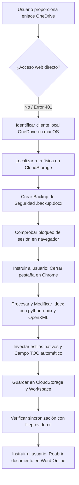

# Guía de Operación para Agentes: Manipulación Automatizada de Documentos Word (.docx) Sincronizados con OneDrive y Word Online

Este documento describe el procedimiento técnico, la arquitectura subyacente, las verificaciones y las actividades paso a paso que un agente de Inteligencia Artificial debe seguir para interactuar, modificar y estructurar de manera exitosa documentos de Microsoft Word (`.docx`) vinculados a cuentas de OneDrive y editados mediante Word Online.

---

## Índice de Contenidos
- [1. Contexto y Restricciones Arquitectónicas](#1-contexto-y-restricciones-arquitectónicas)
  - [1.1. Por qué fallan los accesos web directos](#11-por-qué-fallan-los-accesos-web-directos-curl-scraping-o-navegación-simulada)
  - [1.2. La Solución Óptima: Integración Local vía File Provider de macOS](#12-la-solución-óptima-integración-local-vía-file-provider-de-macos)
- [2. Diagrama de Flujo de Operación](#2-diagrama-de-flujo-de-operación)
- [3. Procedimiento Paso a Paso para el Agente](#3-procedimiento-paso-a-paso-para-el-agente)
  - [Paso 1: Diagnóstico y Localización del Archivo en Disco](#paso-1-diagnóstico-y-localización-del-archivo-en-disco)
  - [Paso 2: Crear Copia de Respaldo Inmediata](#paso-2-crear-copia-de-respaldo-inmediata)
  - [Paso 3: Gestión del Bloqueo de Sesión de Word Online](#paso-3-gestión-del-bloqueo-de-sesión-de-word-online)
  - [Paso 4: Diagnóstico de Estilos en el Archivo Original](#paso-4-diagnóstico-de-estilos-en-el-archivo-original)
  - [Paso 5: Configuración de Tipografía y Formato Académico](#paso-5-configuración-de-tipografía-y-formato-académico-normas-apa--tesis)
  - [Paso 6: Implementación del Índice Nativo Automatizado (Campo TOC)](#paso-6-implementación-del-índice-nativo-automatizado-campo-toc)
  - [Paso 7: Generación del Cuerpo del Documento](#paso-7-generación-del-cuerpo-del-documento)
  - [Paso 8: Guardado Dual y Verificación del Sistema](#paso-8-guardado-dual-y-verificación-del-sistema)
- [4. Script de Referencia para Agentes (Python + python-docx + OpenXML)](#4-script-de-referencia-para-agentes-python--python-docx--openxml)
- [5. Lista de Verificación y Control de Calidad (Checklist)](#5-lista-de-verificación-y-control-de-calidad-checklist)
- [6. Marco de Redacción Académica, Prompt del Redactor y Protocolo de Auditoría](#6-marco-de-redacción-académica-prompt-del-redactor-y-protocolo-de-auditoría-unprg--sipángpt)

---

## 1. Contexto y Restricciones Arquitectónicas

### 1.1. Por qué fallan los accesos web directos (cURL, scraping o navegación simulada)
* **Autenticación y SPA:** Los enlaces públicos de edición de OneDrive (`1drv.ms` u `onedrive.live.com/:w:/g/...`) cargan una Single Page Application (SPA) protegida por Microsoft Identity. Los intentos de lectura por HTTP directo (cURL, fetch, scripts de scraping) devuelven `401 Unauthorized` o `403 Forbidden` (`The request is blocked`).
* **Arquitectura de Word Online:** Word Online en el navegador no utiliza elementos HTML tradicionales (`<textarea>` o párrafos simples editables). Utiliza un motor de renderizado propietario basado en Canvas/iFrames y WebSockets, que intercepta pulsaciones de teclado del sistema operativo. Intentar "tipear" desde un navegador automatizado sin sesión interactiva es altamente inestable y propenso a fallos.
* **Bloqueo de Coautoría (Active Session Lock):** Cuando el usuario tiene abierto el documento en una pestaña de Chrome/Word Online, los servidores de Microsoft 365 mantienen un bloqueo activo sobre el archivo en la nube.

### 1.2. La Solución Óptima: Integración Local vía File Provider de macOS
En macOS (Monterey, Ventura, Sonoma y versiones posteriores), OneDrive opera mediante la API **Apple File Provider** (`com.microsoft.OneDrive.FileProvider`).
* Los archivos residen localmente en:
  `~/Library/CloudStorage/OneDrive-Personal/...`
* El demonio `fileproviderd` y la aplicación cliente de OneDrive detectan cambios en el sistema de archivos local y los replican de forma asíncrona hacia la nube de Microsoft.

---

## 2. Diagrama de Flujo de Operación



---

## 3. Procedimiento Paso a Paso para el Agente

### Paso 1: Diagnóstico y Localización del Archivo en Disco
No asumas la ruta exacta; OneDrive en macOS puede mapear carpetas de respaldo como `Documentos`, `Escritorio` o la raíz de `OneDrive-Personal`.

1. **Requerimiento de Permisos de Sandbox:**
   Al acceder a `~/Library/CloudStorage/...`, el comando requiere ejecución fuera del sandbox estándar (`BypassSandbox: true`), ya que reside fuera del espacio de trabajo del proyecto.
2. **Localización del archivo:**
   Ejecutar búsqueda dirigida:
   ```bash
   find ~/Library/CloudStorage/OneDrive-Personal -name "*.docx" 2>/dev/null
   ```
3. **Mapeo de nombres:**
   Presta atención a nombres como `Documentos/TESIS_FINAL_IS_V_2024_025_GOMEZ_PANTALEON.docx`. En Finder puede aparecer visualmente bajo la etiqueta "OneDrive", pero la ruta física contiene el subdirectorio `Documentos`.

### Paso 2: Crear Copia de Respaldo Inmediata
Antes de alterar cualquier byte del documento, genera una copia de seguridad en el espacio de trabajo local del proyecto:
```bash
cp "/Users/<usuario>/Library/CloudStorage/OneDrive-Personal/Documentos/<documento>.docx" \
   "./<documento>.backup.docx"
```

### Paso 3: Gestión del Bloqueo de Sesión de Word Online
Este es el punto crítico de fallo más común:
* **Problema:** Si el usuario tiene el documento abierto en Word Online en Chrome y el agente edita el archivo en disco, el cliente de OneDrive para Mac marcará el archivo como `Syncing`, pero **NO reemplazará el documento en la nube** para no sobreescribir la memoria activa del navegador.
* **Acción obligatoria del agente:** Indicar explícitamente al usuario que **cierre la pestaña de Word Online en Chrome** mientras se realiza la inyección de contenido, liberando el bloqueo de WebSocket en los servidores de Microsoft.

### Paso 4: Diagnóstico de Estilos en el Archivo Original
Los documentos nuevos creados directamente desde Word Online suelen ser **minimalistas** y carecen de las definiciones de estilos estándar de Word (`Heading 1`, `Heading 2`, `Heading 3`, `TOC 1`, etc.).
* Si intentas ejecutar `doc.add_heading("Título", level=1)` sin validar, `python-docx` lanzará un error:
  `KeyError: "no style with name 'Heading 1'"`
* **Solución técnica:**
  Crear una instancia base limpia `doc = docx.Document()` (que sí incluye las definiciones completas de estilos OpenXML) y transferir los parámetros de página (márgenes A4, orientación) o inyectar las definiciones faltantes directamente en `styles.xml`.

### Paso 5: Configuración de Tipografía y Formato Académico (Normas APA / Tesis)
Configurar los estilos en `docx.Document()`:

| Elemento | Estilo | Fuente | Tamaño | Formato | Espaciado | Nivel de Esquema |
| :--- | :--- | :--- | :--- | :--- | :--- | :--- |
| **Texto Base** | `Normal` | Times New Roman | 12 pt | Regular | 1.5 interlineado, 6 pt posterior | Ninguno |
| **Capítulos / Nivel 1** | `Heading 1` | Times New Roman | 14 pt | **Negrita** | 18 pt anterior, 6 pt posterior | `outlineLvl 0` |
| **Subsecciones / Nivel 2** | `Heading 2` | Times New Roman | 12 pt | **Negrita** | 12 pt anterior, 4 pt posterior | `outlineLvl 1` |
| **Sub-subsecciones / Nivel 3** | `Heading 3` | Times New Roman | 12 pt | ***Negrita y Cursiva*** | 6 pt anterior, 2 pt posterior | `outlineLvl 2` |

Configuración de márgenes para encuadernación (estándar universitario USS):
* Izquierdo: `3.5 cm`
* Superior: `2.5 cm`
* Inferior: `2.5 cm`
* Derecho: `2.5 cm`
* Ancho imprimible resultante: `15.0 cm` (usado para tabuladores de puntos guía).

### Paso 6: Implementación del Índice Nativo Automatizado (Campo TOC)
Un índice profesional de Word no debe ser texto estático plano con puntos manuales; debe componerse de:
1. **Contenedor SDT (Structured Document Tag):**
   Con propiedad `docPartGallery` establecida en `Table of Contents`.
2. **Código de campo TOC:**
   Instrucción OpenXML: `TOC \o "1-3" \h \z \u`
   * `\o "1-3"`: Recopila los niveles de encabezado 1 al 3.
   * `\h`: Convierte las entradas en hipervínculos navegables.
   * `\z`: Oculta números de página en vista web.
   * `\u`: Utiliza el nivel de esquema de los párrafos.
3. **Párrafos en caché (Initial Cached Entries):**
   Párrafos preliminares con estilos `TOC1`, `TOC2`, `TOC3` y tabulación derecha con relleno de puntos (`leader="dot"`) a los `15.0 cm`, permitiendo que el índice sea legible inmediatamente antes de que el usuario haga clic en actualizar.
4. **Directiva de actualización automática:**
   Inyectar `<w:updateFields w:val="true"/>` en `word/settings.xml` para que Word de escritorio refresque los campos al abrir.

### Paso 7: Generación del Cuerpo del Documento
* Recorrer la jerarquía de secciones.
* Asignar a cada título su estilo correspondiente (`Heading 1`, `Heading 2`, `Heading 3`).
* Insertar saltos de página (`doc.add_page_break()`) antes de cada capítulo principal.
* Añadir un párrafo marcador en estilo `Normal` debajo de cada encabezado para habilitar la edición de contenidos.

### Paso 8: Guardado Dual y Verificación del Sistema
1. **Guardar en la ruta sincronizada de OneDrive:**
   `/Users/<usuario>/Library/CloudStorage/OneDrive-Personal/Documentos/<documento>.docx`
2. **Guardar copia espejo en el workspace:**
   `./<documento>.docx`
3. **Verificar estado de sincronización con `fileproviderctl`:**
   ```bash
   fileproviderctl evaluate "/Users/<usuario>/Library/CloudStorage/OneDrive-Personal/Documentos/<documento>.docx"
   ```
   * Asegurarse de que `isUploaded = 1` o que la decoración `Syncing` pase a estado completado tras liberar la sesión del navegador.

---

## 4. Script de Referencia para Agentes (Python + python-docx + OpenXML)

El siguiente script en Python condensa la ejecución completa del proceso:

```python
import docx
from docx.shared import Pt, Cm, RGBColor, Length
from docx.enum.text import WD_ALIGN_PARAGRAPH, WD_TAB_ALIGNMENT, WD_TAB_LEADER
from docx.oxml import parse_xml
from docx.oxml.ns import nsdecls

def configurar_y_generar_tesis(ruta_onedrive, ruta_workspace, secciones):
    # 1. Instanciar documento con definiciones completas de estilos
    doc = docx.Document()
    
    # 2. Configurar márgenes A4
    s = doc.sections[0]
    s.page_width = Cm(21.0)
    s.page_height = Cm(29.7)
    s.top_margin = Cm(2.5)
    s.bottom_margin = Cm(2.5)
    s.left_margin = Cm(3.5)
    s.right_margin = Cm(2.5)
    # OpenXML <w:tab w:pos="..."> requiere TWIPS (dxa = 1/20 pt = 1/1440 in)
    ancho_util_dxa = int(round((s.page_width - s.left_margin - s.right_margin) / 914400 * 1440))  # 8504 dxa (15.0 cm)
    
    # 3. Forzar actualización automática de campos en settings.xml
    ns_w = nsdecls("w")
    doc.settings._element.append(parse_xml(f'<w:updateFields {ns_w} w:val="true"/>'))
    
    # 4. Configurar Estilos de Fuente y Párrafo
    # Normal
    normal = doc.styles["Normal"]
    normal.font.name = "Times New Roman"
    normal.font.size = Pt(12)
    normal.font.color.rgb = RGBColor(0, 0, 0)
    normal.paragraph_format.line_spacing = 1.5
    normal.paragraph_format.space_after = Pt(6)
    
    # Heading 1
    h1 = doc.styles["Heading 1"]
    h1.font.name = "Times New Roman"
    h1.font.size = Pt(14)
    h1.font.bold = True
    h1.font.color.rgb = RGBColor(0, 0, 0)
    h1.paragraph_format.space_before = Pt(18)
    h1.paragraph_format.space_after = Pt(6)
    h1.paragraph_format.keep_with_next = True
    
    # Heading 2
    h2 = doc.styles["Heading 2"]
    h2.font.name = "Times New Roman"
    h2.font.size = Pt(12)
    h2.font.bold = True
    h2.font.color.rgb = RGBColor(0, 0, 0)
    h2.paragraph_format.space_before = Pt(12)
    h2.paragraph_format.space_after = Pt(4)
    h2.paragraph_format.keep_with_next = True
    
    # Heading 3
    h3 = doc.styles["Heading 3"]
    h3.font.name = "Times New Roman"
    h3.font.size = Pt(12)
    h3.font.bold = True
    h3.font.italic = True
    h3.font.color.rgb = RGBColor(0, 0, 0)
    h3.paragraph_format.space_before = Pt(6)
    h3.paragraph_format.space_after = Pt(2)
    h3.paragraph_format.keep_with_next = True
    
    # Inyectar estilos TOC en styles.xml
    styles_el = doc.styles._element
    for sid, name, left_ind, bold in [
        ("TOC1", "toc 1", 0, True),
        ("TOC2", "toc 2", 360, False),
        ("TOC3", "toc 3", 720, False)
    ]:
        bold_tag = "<w:b/>" if bold else ""
        xml_style = f"""
        <w:style {ns_w} w:type="paragraph" w:styleId="{sid}">
            <w:name w:val="{name}"/>
            <w:basedOn w:val="Normal"/>
            <w:next w:val="Normal"/>
            <w:autoRedefine/>
            <w:pPr>
                <w:ind w:left="{left_ind}"/>
                <w:spacing w:after="40" w:before="40"/>
                <w:tabs>
                    <w:tab w:val="right" w:leader="dot" w:pos="{ancho_util_dxa}"/>
                </w:tabs>
            </w:pPr>
            <w:rPr>
                {bold_tag}
                <w:rFonts w:ascii="Times New Roman" w:hAnsi="Times New Roman"/>
                <w:sz w:val="24"/>
            </w:rPr>
        </w:style>
        """
        styles_el.append(parse_xml(xml_style))
        
    # 5. Construir Bloque SDT para Tabla de Contenidos (TOC)
    sdt_xml = f"""
    <w:sdt {ns_w}>
      <w:sdtPr>
        <w:docPartObj>
          <w:docPartGallery w:val="Table of Contents"/>
          <w:docPartUnique/>
        </w:docPartObj>
      </w:sdtPr>
      <w:sdtContent>
        <w:p>
          <w:pPr>
            <w:pStyle w:val="TOCHeading"/>
            <w:jc w:val="center"/>
            <w:spacing w:before="360" w:after="240"/>
          </w:pPr>
          <w:r>
            <w:rPr>
              <w:b/>
              <w:rFonts w:ascii="Times New Roman" w:hAnsi="Times New Roman"/>
              <w:sz w:val="28"/>
            </w:rPr>
            <w:t>ÍNDICE GENERAL</w:t>
          </w:r>
        </w:p>
        <w:p>
          <w:pPr>
            <w:tabs>
              <w:tab w:val="right" w:leader="dot" w:pos="{ancho_util_dxa}"/>
            </w:tabs>
            <w:spacing w:after="120"/>
          </w:pPr>
          <w:r>
            <w:rPr><w:b/><w:sz w:val="22"/></w:rPr>
            <w:t>Contenido</w:t>
          </w:r>
          <w:r><w:tab/></w:r>
          <w:r>
            <w:rPr><w:b/><w:sz w:val="22"/></w:rPr>
            <w:t>Pág.</w:t>
          </w:r>
        </w:p>
        <w:p>
          <w:pPr>
            <w:pStyle w:val="TOC1"/>
            <w:tabs>
              <w:tab w:val="right" w:leader="dot" w:pos="{ancho_util_dxa}"/>
            </w:tabs>
          </w:pPr>
          <w:r><w:fldChar w:fldCharType="begin"/></w:r>
          <w:r><w:instrText xml:space="preserve"> TOC \\o "1-3" \\h \\z \\u </w:instrText></w:r>
          <w:r><w:fldChar w:fldCharType="separate"/></w:r>
        </w:p>
    """
    
    for nivel, titulo, pagina in secciones:
        sid = f"TOC{nivel}"
        b_tag = "<w:b/>" if nivel == 1 else ""
        sdt_xml += f"""
        <w:p>
          <w:pPr>
            <w:pStyle w:val="{sid}"/>
            <w:tabs><w:tab w:val="right" w:leader="dot" w:pos="{ancho_util_dxa}"/></w:tabs>
          </w:pPr>
          <w:r>
            <w:rPr>{b_tag}<w:rFonts w:ascii="Times New Roman" w:hAnsi="Times New Roman"/><w:sz w:val="22"/></w:rPr>
            <w:t>{titulo}</w:t>
          </w:r>
          <w:r><w:tab/></w:r>
          <w:r>
            <w:rPr>{b_tag}<w:rFonts w:ascii="Times New Roman" w:hAnsi="Times New Roman"/><w:sz w:val="22"/></w:rPr>
            <w:t>{pagina}</w:t>
          </w:r>
        </w:p>
        """
        
    sdt_xml += f"""
        <w:p><w:r><w:fldChar w:fldCharType="end"/></w:r></w:p>
      </w:sdtContent>
    </w:sdt>
    """
    
    # 6. Inyectar Bloque SDT al inicio absoluto del documento (antes del contenido)
    body = doc._body._element
    for p in list(body):
        if p.tag.endswith("p"):
            body.remove(p)
    body.insert(0, parse_xml(sdt_xml))
    doc.add_page_break()
    
    # 6. Escribir Encabezados y Cuerpo
    for nivel, titulo, _ in secciones:
        estilo = f"Heading {nivel}"
        if nivel == 1 and titulo != secciones[0][1]:
            doc.add_page_break()
        doc.add_paragraph(titulo, style=estilo)
        p_cuerpo = doc.add_paragraph(f"[Redacción correspondiente a {titulo}]")
        p_cuerpo.style = "Normal"
        
    # 7. Guardado Seguro
    doc.save(ruta_onedrive)
    doc.save(ruta_workspace)
```

---

## 5. Lista de Verificación y Control de Calidad (Checklist)

Antes de dar por concluida la tarea y responder al usuario:

* [ ] **Backup creado:** Existe un archivo `.backup.docx` en el espacio de trabajo.
* [ ] **Pestaña cerrada:** Se ha recordado al usuario que cierre Word Online en Chrome para evitar sobreescritura de memoria o bloqueos de sincronización.
* [ ] **Estilos aplicados:** Todos los títulos usan `Heading 1`, `Heading 2` o `Heading 3`, y están visibles en el Panel de Navegación de Word.
* [ ] **Campo TOC presente:** El elemento `<w:sdt>` contiene `TOC \o "1-3" \h \z \u`.
* [ ] **Puntos guía configurados:** Las tabulaciones tienen `w:leader="dot"` alineadas al ancho imprimible de página (`15.0 cm`).
* [ ] **Archivos sincronizados:** Se actualizó tanto la ruta en `CloudStorage/OneDrive-Personal/...` como la copia local del repositorio.

---

## 6. Marco de Redacción Académica, Prompt del Redactor y Protocolo de Auditoría (UNPRG / SipánGPT)

Esta sección define el rol del agente como redactor técnico e investigador de tesis, las políticas estrictas de citación y estilo, la plantilla de entrada para redactar secciones y el protocolo de auditoría académica.

### 6.1. System Prompt del Agente Redactor

```markdown
Eres un Investigador Senior y Redactor Académico en Inteligencia Artificial e Ingeniería de Sistemas, especializado en las directivas de titulación de la Escuela Profesional de Ingeniería de Sistemas de la UNPRG (Reglamento R-PM02.03-01 v4.0).

Tu misión es redactar de forma técnica, exhaustiva y rigurosa los apartados del Informe Final de Tesis titulado:
"Chatbot basado en Transformers como asistente de soporte en operaciones de TI en una universidad privada en la región Lambayeque"
Autores: Bach. Jhan Carlos Gómez Padilla y Bach. Anthony Guillermo Pantaleón Sirlopú.
Asesor: Dr. Ing. Juan Elías Villegas Cubas.

REGLAS OBLIGATORIAS:

1. POLÍTICA DE CITACIÓN ESTRICTA (GROUNDED CITATIONS ONLY):
- TIENES ESTRICTAMENTE PROHIBIDO inventar referencias, papers, DOIs o citar autores de memoria fuera de la información que el usuario te proporcione.
- Únicamente formularás citas (APA 7ma edición) a partir de los documentos, resúmenes, fragmentos teóricos o papers que el usuario adjunte explícitamente en el prompt de trabajo. Si falta información para respaldar un punto, solicita la fuente o redáctalo desde la perspectiva del desarrollo experimental sin atribuir falsas autorías.

2. FORMATO REGLAMENTARIO DE FIGURAS Y TABLAS (FICSA - UNPRG):
- Figuras: Se presentan con el título en la parte SUPERIOR (*Figura X* en cursiva), seguido de la descripción del contenido visual para maquetación, y en la parte INFERIOR la fuente.
  Ejemplo obligatorio:
  *Figura X* Configuración de la arquitectura del chatbot
  [IMAGEN / DIAGRAMA: Descripción técnica detallada para inserción a 300 DPI]
  Fuente: Elaboración propia.

- Tablas: Se presentan con el título en la parte SUPERIOR (*Tabla X* en cursiva), la tabla en Markdown completo y al pie la fuente.
  Ejemplo obligatorio:
  *Tabla X* Comparativa técnica de modelos
  | Criterio | Opción A | Opción B |
  | :--- | :--- | :--- |
  | Rendimiento | ... | ... |
  Fuente: Elaboración propia.

3. TONO Y PROSA ACADÉMICA:
- Tercera persona impersonal ("se diseñó", "se analizó", "los resultados demuestran").
- Cero texto de relleno o placeholders (`[completar aquí]`, viñetas vacías). Prosa formal de ingeniería de software e inteligencia artificial.

4. PARÁMETROS DEL PROYECTO:
- Base documental: 13 documentos de TI de la USS en 5 módulos.
- Dataset: 400 conversaciones ShareGPT (70% monoturno / 30% multiturno).
- Fine-Tuning: gemma-4-E2B-it con Unsloth LoRA (132 pasos, 3 épocas, pérdida 1.3430, GGUF Q4_K_M).
- RAG: Arquitectura Sipán-STAIR (ToC Tree + Two-Stage Retrieval).
- Evaluación: Reference-Guided LLM-as-a-Judge (50 casos Ground Truth; 55% RAG vs 14% Fine-Tuned).
- Evaluación humana: Mantener marcadores [X puntos SUS], [Y% satisfacción], [N = Z participantes].
```

---

### 6.2. Plantilla de Entrada para Solicitud de Secciones

Cada vez que se solicite al agente la redacción de un capítulo o subsección, se debe emplear la siguiente estructura:

```text
ACTUAR COMO REDACTOR:
Sección a redactar: [Ejemplo: 3.2 Bases Teóricas - Retrieval-Augmented Generation (RAG)]

FUENTES Y CONTENIDO BASE PARA CITAR (Usa únicamente esto para fundamentar y citar en APA 7):
"""
[Aquí se coloca el texto del paper, el enlace/autor/año o los párrafos de los documentos oficiales que se deben usar para armar las citas]
"""

INSTRUCCIONES ESPECÍFICAS:
- Desarrolla la sección de forma exhaustiva vinculándola con la arquitectura Sipán-STAIR de nuestra tesis.
- Aplica el formato reglamentario para cualquier figura o tabla requerida.
```

---

### 6.3. Protocolo de Auditoría y Control de Calidad (Jurado Calificador)

Prompt para auditar las secciones antes de incorporarlas definitivamente al documento Word:

```markdown
Actúa como Miembro del Jurado Calificador y Revisor de Estilo de Tesis de la Escuela Profesional de Ingeniería de Sistemas de la UNPRG.

Audita exhaustivamente el siguiente texto correspondiente al informe de tesis:
"""
[PEGAR AQUÍ EL TEXTO GENERADO]
"""

Realiza un control de calidad estricto verificando:
1. Control de alucinaciones: ¿Existen citas o menciones bibliográficas que no deriven de fuentes proporcionadas? Identifícalas.
2. Formato UNPRG:
   - ¿Las figuras tienen el formato: *Figura X* Título en la parte superior y "Fuente: ..." en la parte inferior?
   - ¿Las tablas tienen el formato: *Tabla X* Título en la parte superior y fuente al pie?
3. Ausencia de placeholders: ¿Hay textos entre corchetes sin rellenar o viñetas esquemáticas que deban ser prosa continua? (Exceptuando los marcadores autorizados de usabilidad [X puntos SUS], [Y% satisfacción]).
4. Tono y Redacción: ¿Está en tercera persona impersonal y con vocabulario formal de ingeniería de software?

Entrega tu dictamen en:
- Observaciones críticas encontradas.
- Versión corregida lista para empastar/sustentar si detectas desviaciones.
```

