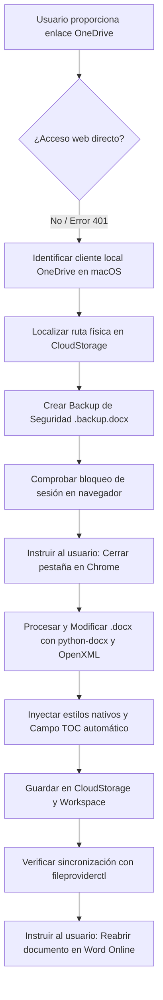

# Guía de Operación para Agentes: Manipulación Automatizada de Documentos Word (.docx) Sincronizados con OneDrive y Word Online

Este documento describe el procedimiento técnico, la arquitectura subyacente, las verificaciones y las actividades paso a paso que un agente de Inteligencia Artificial debe seguir para interactuar, modificar y estructurar de manera exitosa documentos de Microsoft Word (`.docx`) vinculados a cuentas de OneDrive y editados mediante Word Online.

---

## Índice de Contenidos
- [1. Contexto y Restricciones Arquitectónicas](#1-contexto-y-restricciones-arquitectónicas)
  - [1.1. Por qué fallan los accesos web directos](#11-por-qué-fallan-los-accesos-web-directos-curl-scraping-o-navegación-simulada)
  - [1.2. La Solución Óptima: Integración Local vía File Provider de macOS](#12-la-solución-óptima-integración-local-vía-file-provider-de-macos)
- [2. Diagrama de Flujo de Operación](#2-diagrama-de-flujo-de-operación)
- [3. Procedimiento Paso a Paso para el Agente](#3-procedimiento-paso-a-paso-para-el-agente)
  - [Paso 1: Diagnóstico y Localización del Archivo en Disco](#paso-1-diagnóstico-y-localización-del-archivo-en-disco)
  - [Paso 2: Crear Copia de Respaldo Inmediata](#paso-2-crear-copia-de-respaldo-inmediata)
  - [Paso 3: Gestión del Bloqueo de Sesión de Word Online](#paso-3-gestión-del-bloqueo-de-sesión-de-word-online)
  - [Paso 4: Diagnóstico de Estilos en el Archivo Original](#paso-4-diagnóstico-de-estilos-en-el-archivo-original)
  - [Paso 5: Configuración de Tipografía y Formato Académico](#paso-5-configuración-de-tipografía-y-formato-académico-normas-apa--tesis)
  - [Paso 6: Implementación del Índice Nativo Automatizado (Campo TOC)](#paso-6-implementación-del-índice-nativo-automatizado-campo-toc)
  - [Paso 7: Generación del Cuerpo del Documento](#paso-7-generación-del-cuerpo-del-documento)
  - [Paso 8: Guardado Dual y Verificación del Sistema](#paso-8-guardado-dual-y-verificación-del-sistema)
- [4. Scripts de Referencia para Agentes (Python + python-docx + OpenXML)](#4-scripts-de-referencia-para-agentes-python--python-docx--openxml)
  - [4.1. Generación Completa y Estructuración Base](#41-generación-completa-y-estructuración-base)
  - [4.2. Edición Quirúrgica y Gestión Dinámica de Referencias](#42-edición-quirúrgica-y-gestión-dinámica-de-referencias)
- [5. Lista de Verificación y Control de Calidad (Checklist)](#5-lista-de-verificación-y-control-de-calidad-checklist)
- [6. Marco de Redacción Académica, Prompt del Redactor y Protocolo de Auditoría](#6-marco-de-redacción-académica-prompt-del-redactor-y-protocolo-de-auditoría-unprg--sipángpt)
- [7. Lecciones Aprendidas, Patrones Críticos y Antipatrones Operativos](#7-lecciones-aprendidas-patrones-críticos-y-antipatrones-operativos)
  - [7.1. Antipatrón de Alucinación Estructural y Principio "Strict Boundary"](#71-antipatrón-de-alucinación-estructural-y-principio-strict-boundary)
  - [7.2. Patrón de Edición Quirúrgica de .docx (Preservación vs. Reescritura Destructiva)](#72-patrón-de-edición-quirúrgica-de-docx-preservación-vs-reescritura-destructiva)
  - [7.3. Manejo de Permisos y Sandbox en macOS (CloudStorage y Git Locks)](#73-manejo-de-permisos-y-sandbox-en-macos-cloudstorage-y-git-locks)
  - [7.4. Protocolo Dual Espejo y Trazabilidad Git](#74-protocolo-dual-espejo-y-trazabilidad-git)
  - [7.5. Mapeo Reglamentario de Preliminares y Prevención de Desbordes en Índices](#75-mapeo-reglamentario-de-preliminares-y-prevención-de-desbordes-en-índices)
  - [7.6. Gestión Dinámica y Consistente de Referencias APA 7ma Edición](#76-gestión-dinámica-y-consistente-de-referencias-apa-7ma-edición)
  - [7.7. Reglas Ortográficas y de Estilo en Español: Erradicación de Anglicismos Tipográficos y Numéricos](#77-reglas-ortográficas-y-de-estilo-en-español-erradicación-de-anglicismos-tipográficos-y-numéricos)
  - [7.8. Configuración de Numeración Automática en Pie de Página y Partición de Secciones](#78-configuración-de-numeración-automática-en-pie-de-página-y-partición-de-secciones)
- [8. Cronología Exhaustiva de Actividades y Pasos Ejecutados (Bitácora de Construcción)](#8-cronología-exhaustiva-de-actividades-y-pasos-ejecutados-bitácora-de-construcción)
  - [8.1. Hito 1: Diagnóstico de accesibilidad a OneDrive y descarte de scraping web](#81-hito-1-diagnóstico-de-accesibilidad-a-onedrive-y-descarte-de-scraping-web)
  - [8.2. Hito 2: Integración local vía File Provider y protocolo espejo dual](#82-hito-2-integración-local-vía-file-provider-y-protocolo-espejo-dual)
  - [8.3. Hito 3: Estructuración canónica del documento Word (A4, márgenes USS, TOC nativo, preliminares)](#83-hito-3-estructuración-canónica-del-documento-word-a4-márgenes-uss-toc-nativo-preliminares)
  - [8.4. Hito 4: Redacción e inyección del Capítulo 1 (Introducción completa)](#84-hito-4-redacción-e-inyección-del-capítulo-1-introducción-completa)
  - [8.5. Hito 5: Foliación nativa automática reiniciando en página 1 desde la Introducción](#85-hito-5-foliación-nativa-automática-reiniciando-en-página-1-desde-la-introducción)
  - [8.6. Hito 6: Protocolo de auditoría y erradicación sistemática de vicios ortográficos](#86-hito-6-protocolo-de-auditoría-y-erradicación-sistemática-de-vicios-ortográficos)
  - [8.7. Hito 7: Redacción de 2.1 Antecedentes con 25 estudios empíricos cuantitativos](#87-hito-7-redacción-de-21-antecedentes-con-25-estudios-empíricos-cuantitativos)
  - [8.8. Hito 8: Ingesta de evidencia científica y redacción de 2.2 Bases Teóricas (Strict Boundary)](#88-hito-8-ingesta-de-evidencia-científica-y-redacción-de-22-bases-teóricas-strict-boundary)
  - [8.9. Hito 9: Consolidación dinámica del Capítulo 8 (Referencias) con 33 fuentes APA 7ma edición](#89-hito-9-consolidación-dinámica-del-capítulo-8-referencias-con-33-fuentes-apa-7ma-edición)
  - [8.10. Hito 10: Actualización del RESUMEN y ABSTRACT con métricas de la Segunda Tanda](#810-hito-10-actualización-del-resumen-y-abstract-con-métricas-de-la-segunda-tanda)
  - [8.11. Hito 11: Anonimización institucional, neutralización de marcas y definición cultural formal](#811-hito-11-anonimización-institucional-neutralización-de-marcas-y-definición-cultural-formal)
- [9. Guía Integral de Compatibilidad Multiplataforma (macOS y Windows)](#9-guía-integral-de-compatibilidad-multiplataforma-macos-y-windows)
  - [9.1. Arquitecturas de sincronización: Apple File Provider vs. Windows Cloud Files API (NTFS)](#91-arquitecturas-de-sincronización-apple-file-provider-vs-windows-cloud-files-api-ntfs)
  - [9.2. Módulo de resolución de rutas dinámicas: scripts/platform_utils.py](#92-módulo-de-resolución-de-rutas-dinámicas-scriptsplatform_utilspy)
  - [9.3. Gestión de bloqueos de archivo en Windows ([WinError 32]) y Word Online](#93-gestión-de-bloqueos-de-archivo-en-windows-winerror-32-y-word-online)
  - [9.4. Normalización de rutas, codificación UTF-8 y line endings (.gitattributes)](#94-normalización-de-rutas-codificación-utf-8-y-line-endings-gitattributes)
  - [9.5. Guía de ejecución paso a paso en Windows (PowerShell/CMD) y macOS (Terminal/Zsh)](#95-guía-de-ejecución-paso-a-paso-en-windows-powershellcmd-y-macos-terminalzsh)
- [10. Seguridad, Manejo de Secretos y Políticas de Publicación en GitHub](#10-seguridad-manejo-de-secretos-y-políticas-de-publicación-en-github)
  - [10.1. Política estricta de exclusión de credenciales (.env*, llaves privadas, tokens)](#101-política-estricta-de-exclusión-de-credenciales-env-llaves-privadas-tokens)
  - [10.2. Procedimiento de verificación previa a git push](#102-procedimiento-de-verificación-previa-a-git-push)
- [11. Protocolo Operativo para Agentes Nuevos o Continuadores de Sesión](#11-protocolo-operativo-para-agentes-nuevos-o-continuadores-de-sesión)

---

## 1. Contexto y Restricciones Arquitectónicas

### 1.1. Por qué fallan los accesos web directos (cURL, scraping o navegación simulada)
* **Autenticación y SPA:** Los enlaces públicos de edición de OneDrive (`1drv.ms` u `onedrive.live.com/:w:/g/...`) cargan una Single Page Application (SPA) protegida por Microsoft Identity. Los intentos de lectura por HTTP directo (cURL, fetch, scripts de scraping) devuelven `401 Unauthorized` o `403 Forbidden` (`The request is blocked`).
* **Arquitectura de Word Online:** Word Online en el navegador no utiliza elementos HTML tradicionales (`<textarea>` o párrafos simples editables). Utiliza un motor de renderizado propietario basado en Canvas/iFrames y WebSockets, que intercepta pulsaciones de teclado del sistema operativo. Intentar "tipear" desde un navegador automatizado sin sesión interactiva es altamente inestable y propenso a fallos.
* **Bloqueo de Coautoría (Active Session Lock):** Cuando el usuario tiene abierto el documento en una pestaña de Chrome/Word Online, los servidores de Microsoft 365 mantienen un bloqueo activo sobre el archivo en la nube.

### 1.2. La Solución Óptima: Integración Local vía File Provider de macOS
En macOS (Monterey, Ventura, Sonoma y versiones posteriores), OneDrive opera mediante la API **Apple File Provider** (`com.microsoft.OneDrive.FileProvider`).
* Los archivos residen localmente en:
  `~/Library/CloudStorage/OneDrive-Personal/...`
* El demonio `fileproviderd` y la aplicación cliente de OneDrive detectan cambios en el sistema de archivos local y los replican de forma asíncrona hacia la nube de Microsoft.

---

## 2. Diagrama de Flujo de Operación



---

## 3. Procedimiento Paso a Paso para el Agente

### Paso 1: Diagnóstico y Localización del Archivo en Disco
No asumas la ruta exacta; OneDrive en macOS puede mapear carpetas de respaldo como `Documentos`, `Escritorio` o la raíz de `OneDrive-Personal`.

1. **Requerimiento de Permisos de Sandbox:**
   Al acceder a `~/Library/CloudStorage/...`, el comando requiere ejecución fuera del sandbox estándar (`BypassSandbox: true`), ya que reside fuera del espacio de trabajo del proyecto.
2. **Localización del archivo:**
   Ejecutar búsqueda dirigida:
   ```bash
   find ~/Library/CloudStorage/OneDrive-Personal -name "*.docx" 2>/dev/null
   ```
3. **Mapeo de nombres:**
   Presta atención a nombres como `Documentos/TESIS_FINAL_IS_V_2024_025_GOMEZ_PANTALEON.docx`. En Finder puede aparecer visualmente bajo la etiqueta "OneDrive", pero la ruta física contiene el subdirectorio `Documentos`.

### Paso 2: Crear Copia de Respaldo Inmediata
Antes de alterar cualquier byte del documento, genera una copia de seguridad en el espacio de trabajo local del proyecto:
```bash
cp "/Users/<usuario>/Library/CloudStorage/OneDrive-Personal/Documentos/<documento>.docx" \
   "./<documento>.backup.docx"
```

### Paso 3: Gestión del Bloqueo de Sesión de Word Online
Este es el punto crítico de fallo más común:
* **Problema:** Si el usuario tiene el documento abierto en Word Online en Chrome y el agente edita el archivo en disco, el cliente de OneDrive para Mac marcará el archivo como `Syncing`, pero **NO reemplazará el documento en la nube** para no sobreescribir la memoria activa del navegador.
* **Acción obligatoria del agente:** Indicar explícitamente al usuario que **cierre la pestaña de Word Online en Chrome** mientras se realiza la inyección de contenido, liberando el bloqueo de WebSocket en los servidores de Microsoft.

### Paso 4: Diagnóstico de Estilos en el Archivo Original
Los documentos nuevos creados directamente desde Word Online suelen ser **minimalistas** y carecen de las definiciones de estilos estándar de Word (`Heading 1`, `Heading 2`, `Heading 3`, `TOC 1`, etc.).
* Si intentas ejecutar `doc.add_heading("Título", level=1)` sin validar, `python-docx` lanzará un error:
  `KeyError: "no style with name 'Heading 1'"`
* **Solución técnica:**
  Crear una instancia base limpia `doc = docx.Document()` (que sí incluye las definiciones completas de estilos OpenXML) y transferir los parámetros de página (márgenes A4, orientación) o inyectar las definiciones faltantes directamente en `styles.xml`.

### Paso 5: Configuración de Tipografía y Formato Académico (Normas APA / Tesis)
Configurar los estilos en `docx.Document()`:

| Elemento | Estilo | Fuente | Tamaño | Formato | Espaciado | Nivel de Esquema |
| :--- | :--- | :--- | :--- | :--- | :--- | :--- |
| **Texto Base** | `Normal` | Times New Roman | 12 pt | Regular | 1.5 interlineado, 6 pt posterior | Ninguno |
| **Capítulos / Nivel 1** | `Heading 1` | Times New Roman | 14 pt | **Negrita** | 18 pt anterior, 6 pt posterior | `outlineLvl 0` |
| **Subsecciones / Nivel 2** | `Heading 2` | Times New Roman | 12 pt | **Negrita** | 12 pt anterior, 4 pt posterior | `outlineLvl 1` |
| **Sub-subsecciones / Nivel 3** | `Heading 3` | Times New Roman | 12 pt | ***Negrita y Cursiva*** | 6 pt anterior, 2 pt posterior | `outlineLvl 2` |

Configuración de márgenes para encuadernación (estándar universitario USS):
* Izquierdo: `3.5 cm`
* Superior: `2.5 cm`
* Inferior: `2.5 cm`
* Derecho: `2.5 cm`
* Ancho imprimible resultante: `15.0 cm` (usado para tabuladores de puntos guía).

### Paso 6: Implementación del Índice Nativo Automatizado (Campo TOC)
Un índice profesional de Word no debe ser texto estático plano con puntos manuales; debe componerse de:
1. **Contenedor SDT (Structured Document Tag):**
   Con propiedad `docPartGallery` establecida en `Table of Contents`.
2. **Código de campo TOC:**
   Instrucción OpenXML: `TOC \o "1-3" \h \z \u`
   * `\o "1-3"`: Recopila los niveles de encabezado 1 al 3.
   * `\h`: Convierte las entradas en hipervínculos navegables.
   * `\z`: Oculta números de página en vista web.
   * `\u`: Utiliza el nivel de esquema de los párrafos.
3. **Párrafos en caché (Initial Cached Entries):**
   Párrafos preliminares con estilos `TOC1`, `TOC2`, `TOC3` y tabulación derecha con relleno de puntos (`leader="dot"`) a los `15.0 cm`, permitiendo que el índice sea legible inmediatamente antes de que el usuario haga clic en actualizar.
4. **Directiva de actualización automática:**
   Inyectar `<w:updateFields w:val="true"/>` en `word/settings.xml` para que Word de escritorio refresque los campos al abrir.

### Paso 7: Generación del Cuerpo del Documento
* Recorrer la jerarquía de secciones.
* Asignar a cada título su estilo correspondiente (`Heading 1`, `Heading 2`, `Heading 3`).
* Insertar saltos de página (`doc.add_page_break()`) antes de cada capítulo principal.
* Añadir un párrafo marcador en estilo `Normal` debajo de cada encabezado para habilitar la edición de contenidos.

### Paso 8: Guardado Dual y Verificación del Sistema
1. **Guardar en la ruta sincronizada de OneDrive:**
   `/Users/<usuario>/Library/CloudStorage/OneDrive-Personal/Documentos/<documento>.docx`
2. **Guardar copia espejo en el workspace:**
   `./<documento>.docx`
3. **Verificar estado de sincronización con `fileproviderctl`:**
   ```bash
   fileproviderctl evaluate "/Users/<usuario>/Library/CloudStorage/OneDrive-Personal/Documentos/<documento>.docx"
   ```
   * Asegurarse de que `isUploaded = 1` o que la decoración `Syncing` pase a estado completado tras liberar la sesión del navegador.

---

## 4. Scripts de Referencia para Agentes (Python + python-docx + OpenXML)

### 4.1. Generación y Estructuración Inicial Completa
El siguiente script en Python condensa la inicialización desde cero, inyección de estilos, márgenes A4 y tabla de contenidos (TOC) nativa:

```python
import docx
from docx.shared import Pt, Cm, RGBColor, Length
from docx.enum.text import WD_ALIGN_PARAGRAPH, WD_TAB_ALIGNMENT, WD_TAB_LEADER
from docx.oxml import parse_xml
from docx.oxml.ns import nsdecls

def configurar_y_generar_tesis(ruta_onedrive, ruta_workspace, secciones):
    # 1. Instanciar documento con definiciones completas de estilos
    doc = docx.Document()
    
    # 2. Configurar márgenes A4
    s = doc.sections[0]
    s.page_width = Cm(21.0)
    s.page_height = Cm(29.7)
    s.top_margin = Cm(2.5)
    s.bottom_margin = Cm(2.5)
    s.left_margin = Cm(3.5)
    s.right_margin = Cm(2.5)
    # OpenXML <w:tab w:pos="..."> requiere TWIPS (dxa = 1/20 pt = 1/1440 in)
    ancho_util_dxa = int(round((s.page_width - s.left_margin - s.right_margin) / 914400 * 1440))  # 8504 dxa (15.0 cm)
    
    # 3. Forzar actualización automática de campos en settings.xml
    ns_w = nsdecls("w")
    doc.settings._element.append(parse_xml(f'<w:updateFields {ns_w} w:val="true"/>'))
    
    # 4. Configurar Estilos de Fuente y Párrafo
    # Normal
    normal = doc.styles["Normal"]
    normal.font.name = "Times New Roman"
    normal.font.size = Pt(12)
    normal.font.color.rgb = RGBColor(0, 0, 0)
    normal.paragraph_format.line_spacing = 1.5
    normal.paragraph_format.space_after = Pt(6)
    
    # Heading 1
    h1 = doc.styles["Heading 1"]
    h1.font.name = "Times New Roman"
    h1.font.size = Pt(14)
    h1.font.bold = True
    h1.font.color.rgb = RGBColor(0, 0, 0)
    h1.paragraph_format.space_before = Pt(18)
    h1.paragraph_format.space_after = Pt(6)
    h1.paragraph_format.keep_with_next = True
    
    # Heading 2
    h2 = doc.styles["Heading 2"]
    h2.font.name = "Times New Roman"
    h2.font.size = Pt(12)
    h2.font.bold = True
    h2.font.color.rgb = RGBColor(0, 0, 0)
    h2.paragraph_format.space_before = Pt(12)
    h2.paragraph_format.space_after = Pt(4)
    h2.paragraph_format.keep_with_next = True
    
    # Heading 3
    h3 = doc.styles["Heading 3"]
    h3.font.name = "Times New Roman"
    h3.font.size = Pt(12)
    h3.font.bold = True
    h3.font.italic = True
    h3.font.color.rgb = RGBColor(0, 0, 0)
    h3.paragraph_format.space_before = Pt(6)
    h3.paragraph_format.space_after = Pt(2)
    h3.paragraph_format.keep_with_next = True
    
    # Inyectar estilos TOC en styles.xml
    styles_el = doc.styles._element
    for sid, name, left_ind, bold in [
        ("TOC1", "toc 1", 0, True),
        ("TOC2", "toc 2", 360, False),
        ("TOC3", "toc 3", 720, False)
    ]:
        bold_tag = "<w:b/>" if bold else ""
        xml_style = f"""
        <w:style {ns_w} w:type="paragraph" w:styleId="{sid}">
            <w:name w:val="{name}"/>
            <w:basedOn w:val="Normal"/>
            <w:next w:val="Normal"/>
            <w:autoRedefine/>
            <w:pPr>
                <w:ind w:left="{left_ind}"/>
                <w:spacing w:after="40" w:before="40"/>
                <w:tabs>
                    <w:tab w:val="right" w:leader="dot" w:pos="{ancho_util_dxa}"/>
                </w:tabs>
            </w:pPr>
            <w:rPr>
                {bold_tag}
                <w:rFonts w:ascii="Times New Roman" w:hAnsi="Times New Roman"/>
                <w:sz w:val="24"/>
            </w:rPr>
        </w:style>
        """
        styles_el.append(parse_xml(xml_style))
        
    # 5. Construir Bloque SDT para Tabla de Contenidos (TOC)
    sdt_xml = f"""
    <w:sdt {ns_w}>
      <w:sdtPr>
        <w:docPartObj>
          <w:docPartGallery w:val="Table of Contents"/>
          <w:docPartUnique/>
        </w:docPartObj>
      </w:sdtPr>
      <w:sdtContent>
        <w:p>
          <w:pPr>
            <w:pStyle w:val="TOCHeading"/>
            <w:jc w:val="center"/>
            <w:spacing w:before="360" w:after="240"/>
          </w:pPr>
          <w:r>
            <w:rPr>
              <w:b/>
              <w:rFonts w:ascii="Times New Roman" w:hAnsi="Times New Roman"/>
              <w:sz w:val="28"/>
            </w:rPr>
            <w:t>ÍNDICE GENERAL</w:t>
          </w:r>
        </w:p>
        <w:p>
          <w:pPr>
            <w:tabs>
              <w:tab w:val="right" w:leader="dot" w:pos="{ancho_util_dxa}"/>
            </w:tabs>
            <w:spacing w:after="120"/>
          </w:pPr>
          <w:r>
            <w:rPr><w:b/><w:sz w:val="22"/></w:rPr>
            <w:t>Contenido</w:t>
          </w:r>
          <w:r><w:tab/></w:r>
          <w:r>
            <w:rPr><w:b/><w:sz w:val="22"/></w:rPr>
            <w:t>Pág.</w:t>
          </w:r>
        </w:p>
        <w:p>
          <w:pPr>
            <w:pStyle w:val="TOC1"/>
            <w:tabs>
              <w:tab w:val="right" w:leader="dot" w:pos="{ancho_util_dxa}"/>
            </w:tabs>
          </w:pPr>
          <w:r><w:fldChar w:fldCharType="begin"/></w:r>
          <w:r><w:instrText xml:space="preserve"> TOC \\o "1-3" \\h \\z \\u </w:instrText></w:r>
          <w:r><w:fldChar w:fldCharType="separate"/></w:r>
        </w:p>
    """
    
    for nivel, titulo, pagina in secciones:
        sid = f"TOC{nivel}"
        b_tag = "<w:b/>" if nivel == 1 else ""
        sdt_xml += f"""
        <w:p>
          <w:pPr>
            <w:pStyle w:val="{sid}"/>
            <w:tabs><w:tab w:val="right" w:leader="dot" w:pos="{ancho_util_dxa}"/></w:tabs>
          </w:pPr>
          <w:r>
            <w:rPr>{b_tag}<w:rFonts w:ascii="Times New Roman" w:hAnsi="Times New Roman"/><w:sz w:val="22"/></w:rPr>
            <w:t>{titulo}</w:t>
          </w:r>
          <w:r><w:tab/></w:r>
          <w:r>
            <w:rPr>{b_tag}<w:rFonts w:ascii="Times New Roman" w:hAnsi="Times New Roman"/><w:sz w:val="22"/></w:rPr>
            <w:t>{pagina}</w:t>
          </w:r>
        </w:p>
        """
        
    sdt_xml += f"""
        <w:p><w:r><w:fldChar w:fldCharType="end"/></w:r></w:p>
      </w:sdtContent>
    </w:sdt>
    """
    
    # 6. Inyectar Bloque SDT al inicio absoluto del documento (antes del contenido)
    body = doc._body._element
    for p in list(body):
        if p.tag.endswith("p"):
            body.remove(p)
    body.insert(0, parse_xml(sdt_xml))
    doc.add_page_break()
    
    # 6. Escribir Encabezados y Cuerpo
    for nivel, titulo, _ in secciones:
        estilo = f"Heading {nivel}"
        if nivel == 1 and titulo != secciones[0][1]:
            doc.add_page_break()
        doc.add_paragraph(titulo, style=estilo)
        p_cuerpo = doc.add_paragraph(f"[Redacción correspondiente a {titulo}]")
        p_cuerpo.style = "Normal"
        
    # 7. Guardado Seguro
    doc.save(ruta_onedrive)
    doc.save(ruta_workspace)
```

### 4.2. Edición Quirúrgica y Gestión Dinámica de Referencias
Cuando el documento ya contiene páginas preliminares, índices y secciones redactadas, **NO se debe regenerar el documento desde cero**. En su lugar, se debe abrir el archivo existente, localizar los párrafos ancla mediante coincidencia de texto, modificar su contenido o insertar párrafos subsiguientes usando la API interna OpenXML (`curr._p.addnext(new_p._p)`), y actualizar la sección de referencias preservando la sangría francesa y el orden alfabético:

```python
import docx
from docx.shared import Pt, Cm, RGBColor
from docx.enum.text import WD_ALIGN_PARAGRAPH

def edicion_quirurgica_docx(ruta_archivo, texto_p2_nuevo, nuevos_parrafos_finales, lista_referencias_apa):
    doc = docx.Document(ruta_archivo)
    
    # 1. Modificación de un párrafo específico (ancla)
    for p in doc.paragraphs:
        if "Texto identificador del párrafo a sustituir" in p.text:
            p.text = ""
            p.alignment = WD_ALIGN_PARAGRAPH.JUSTIFY
            p.paragraph_format.line_spacing = 1.5
            p.paragraph_format.space_after = Pt(6)
            r = p.add_run(texto_p2_nuevo)
            r.font.name = "Times New Roman"
            r.font.size = Pt(12)
            r.font.color.rgb = RGBColor(0, 0, 0)
            break

    # 2. Inserción de múltiples párrafos contiguos mediante _p.addnext()
    p_ancla = None
    for p in doc.paragraphs:
        if "Texto identificador del último párrafo previo" in p.text:
            p_ancla = p
            break
            
    if p_ancla:
        # Reemplazar el párrafo ancla con el primer bloque
        p_ancla.text = ""
        p_ancla.alignment = WD_ALIGN_PARAGRAPH.JUSTIFY
        p_ancla.paragraph_format.line_spacing = 1.5
        p_ancla.paragraph_format.space_after = Pt(6)
        r = p_ancla.add_run(nuevos_parrafos_finales[0])
        r.font.name = "Times New Roman"
        r.font.size = Pt(12)
        r.font.color.rgb = RGBColor(0, 0, 0)
        
        # Insertar los párrafos siguientes secuencialmente
        curr = p_ancla
        for bloque in nuevos_parrafos_finales[1:]:
            new_p = doc.add_paragraph()
            new_p.alignment = WD_ALIGN_PARAGRAPH.JUSTIFY
            new_p.paragraph_format.line_spacing = 1.5
            new_p.paragraph_format.space_after = Pt(6)
            r = new_p.add_run(bloque)
            r.font.name = "Times New Roman"
            r.font.size = Pt(12)
            r.font.color.rgb = RGBColor(0, 0, 0)
            curr._p.addnext(new_p._p)
            curr = new_p

    # 3. Actualización de la sección de Referencias (Capítulo 8) con Sangría Francesa
    p_ref_heading = None
    ref_paras = []
    in_ref = False
    
    for p in doc.paragraphs:
        if p.text.strip() == "8. REFERENCIAS":
            p_ref_heading = p
            in_ref = True
            continue
        if in_ref:
            if p.text.strip().startswith("9. ANEXOS"):
                break
            if p.text.strip():
                ref_paras.append(p)
                
    # Eliminar párrafos anteriores de referencias
    for p in ref_paras:
        p._p.getparent().remove(p._p)
        
    # Inyectar lista ordenada alfabéticamente con sangría francesa (1.27 cm / 0.5 in)
    curr_ref = p_ref_heading
    for ref_runs in lista_referencias_apa:
        new_p = doc.add_paragraph()
        new_p.alignment = WD_ALIGN_PARAGRAPH.JUSTIFY
        new_p.paragraph_format.line_spacing = 1.5
        new_p.paragraph_format.space_after = Pt(6)
        new_p.paragraph_format.left_indent = Cm(1.27)
        new_p.paragraph_format.first_line_indent = Cm(-1.27)
        for fragmento, es_cursiva in ref_runs:
            r = new_p.add_run(fragmento)
            r.font.name = "Times New Roman"
            r.font.size = Pt(12)
            r.italic = es_cursiva
        curr_ref._p.addnext(new_p._p)
        curr_ref = new_p
        
    doc.save(ruta_archivo)
```

---

## 5. Lista de Verificación y Control de Calidad (Checklist)

Antes de dar por concluida la tarea y responder al usuario:

* [ ] **Límites de contenido respetados (Strict Boundary):** Solo se redactó o modificó la sección autorizada sin inventar contenido ni rellenar capítulos futuros no aprobados.
* [ ] **Backup creado:** Existe un archivo `.backup.docx` en el espacio de trabajo antes de iniciar la intervención.
* [ ] **Pestaña cerrada:** Se ha recordado al usuario que cierre Word Online en Chrome para evitar sobreescritura de memoria o bloqueos de sincronización.
* [ ] **Estilos aplicados:** Todos los títulos usan `Heading 1`, `Heading 2` o `Heading 3`, y están visibles en el Panel de Navegación de Word.
* [ ] **Campo TOC y geometría válida:** El elemento `<w:sdt>` contiene `TOC \o "1-3" \h \z \u` con puntos guía (`w:leader="dot"`) alineados al ancho útil (`15.0 cm` = 8504 dxa), sin desbordes de línea.
* [ ] **Edición quirúrgica aplicada:** Si el documento ya tenía estructura y secciones previas, se modificaron los párrafos ancla o se insertaron nuevos vía `_p.addnext()`, sin destruir el documento base.
* [ ] **Referencias sincronizadas:** Toda cita añadida en el cuerpo se incluyó inmediatamente en la sección 8 en orden estrictamente alfabético y con sangría francesa (1.27 cm).
* [ ] **Cero corchetes numéricos en citas:** No se emplean citas numéricas estilo IEEE o notas entre corchetes (`[1]`, `[1, 5]`, `[2]`). Toda cita en el cuerpo debe ajustarse estrictamente a APA 7ma edición con autor y año: `(Apellido, Año)` o `Apellido (Año)`. (Solo se permiten marcadores cuantitativos de usabilidad expresamente aprobados como `[X puntos SUS]`).
* [ ] **Erradicación de la coma de Oxford en español:** No debe colocarse coma antes de las conjunciones copulativas "y" o "e" (`", y"` / `", e"`), salvo en casos excepcionales de oraciones independientes complejas con diferente sujeto según la RAE. En enumeraciones y oraciones compuestas estándar en español, la coma antes de la "y" es un calco del inglés (*Oxford comma*) que debe sustituirse por `" y"` o reestructurarse con enlaces como `", así como"`.
* [ ] **Eliminación de la raya larga (em-dash `—`):** No utilizar el carácter tipográfico de raya larga o em-dash (`—`, U+2014) en la redacción de la prosa en español para oraciones aclaratorias o incisos parentéticos. Deben emplearse paréntesis convencionales `(...)`, comas explicativas o puntos seguidos, preservando la sobriedad y legibilidad en documentos académicos impresos.
* [ ] **Paginación automática configurada (Word nativo):** El pie de página de la Sección 1 (a partir de 1. INTRODUCCIÓN) está desvinculado de las páginas preliminares (`is_linked_to_previous = False`), alineado a la derecha, con el campo nativo dinámico `PAGE` en Times New Roman 12 pt, y reinicia en 1 con formato decimal (`w:fmt="decimal" w:start="1"`). Las páginas preliminares no muestran numeración visible en carátula.
* [ ] **Archivos sincronizados (Sincronización Tripartita):** Se actualizaron simultáneamente:
  1. La ruta en `CloudStorage/OneDrive-Personal/Documentos/...`
  2. La copia local en el espacio de trabajo `./TESIS_FINAL_IS_V_2024_025_GOMEZ_PANTALEON.docx`
  3. El archivo espejo [TESIS.md](file:///Users/jhan/Documents/Proyectos/tesis/Documento_de_tesis/TESIS.md).
* [ ] **Commit de Git descriptivo:** Se generó un commit en Git con mensaje convencional detallado (`feat:`, `fix:`, `docs:`) que especifica la sección alterada y la naturaleza del cambio.
* [ ] **Verificación de sincronización OneDrive:** Se evaluó con `fileproviderctl evaluate` confirmando `isUploaded = 1`.

---

## 6. Marco de Redacción Académica, Prompt del Redactor y Protocolo de Auditoría (UNPRG / SipánGPT)

Esta sección define el rol del agente como redactor técnico e investigador de tesis, las políticas estrictas de citación y estilo, la plantilla de entrada para redactar secciones y el protocolo de auditoría académica.

### 6.1. System Prompt del Agente Redactor

```markdown
Eres un Investigador Senior y Redactor Académico en Inteligencia Artificial e Ingeniería de Sistemas, especializado en las directivas de titulación de la Escuela Profesional de Ingeniería de Sistemas de la UNPRG (Reglamento R-PM02.03-01 v4.0).

Tu misión es redactar de forma técnica, exhaustiva y rigurosa los apartados del Informe Final de Tesis titulado:
"Chatbot basado en Transformers como asistente de soporte en operaciones de TI en una universidad privada en la región Lambayeque"
Autores: Bach. Jhan Carlos Gómez Padilla y Bach. Anthony Guillermo Pantaleón Sirlopú.
Asesor: Dr. Ing. Juan Elías Villegas Cubas.

REGLAS OBLIGATORIAS:

1. POLÍTICA DE CITACIÓN ESTRICTA (GROUNDED CITATIONS ONLY):
- TIENES ESTRICTAMENTE PROHIBIDO inventar referencias, papers, DOIs o citar autores de memoria fuera de la información que el usuario te proporcione.
- Únicamente formularás citas (APA 7ma edición) a partir de los documentos, resúmenes, fragmentos teóricos o papers que el usuario adjunte explícitamente en el prompt de trabajo. Si falta información para respaldar un punto, solicita la fuente o redáctalo desde la perspectiva del desarrollo experimental sin atribuir falsas autorías.

2. FORMATO REGLAMENTARIO DE FIGURAS Y TABLAS (FICSA - UNPRG):
- Figuras: Se presentan con el título en la parte SUPERIOR (*Figura X* en cursiva), seguido de la descripción del contenido visual para maquetación, y en la parte INFERIOR la fuente.
  Ejemplo obligatorio:
  *Figura X* Configuración de la arquitectura del chatbot
  [IMAGEN / DIAGRAMA: Descripción técnica detallada para inserción a 300 DPI]
  Fuente: Elaboración propia.

- Tablas: Se presentan con el título en la parte SUPERIOR (*Tabla X* en cursiva), la tabla en Markdown completo y al pie la fuente.
  Ejemplo obligatorio:
  *Tabla X* Comparativa técnica de modelos
  | Criterio | Opción A | Opción B |
  | :--- | :--- | :--- |
  | Rendimiento | ... | ... |
  Fuente: Elaboración propia.

3. TONO Y PROSA ACADÉMICA:
- Tercera persona impersonal ("se diseñó", "se analizó", "los resultados demuestran").
- Cero texto de relleno o placeholders (`[completar aquí]`, viñetas vacías). Prosa formal de ingeniería de software e inteligencia artificial.

4. PARÁMETROS DEL PROYECTO:
- Base documental: 13 documentos de TI de la USS en 5 módulos.
- Dataset: 400 conversaciones ShareGPT (70% monoturno / 30% multiturno).
- Fine-Tuning: gemma-4-E2B-it con Unsloth LoRA (132 pasos, 3 épocas, pérdida 1.3430, GGUF Q4_K_M).
- RAG: Arquitectura Sipán-STAIR (ToC Tree + Two-Stage Retrieval).
- Evaluación: Reference-Guided LLM-as-a-Judge (50 casos Ground Truth; 55% RAG vs 14% Fine-Tuned).
- Evaluación humana: Mantener marcadores [X puntos SUS], [Y% satisfacción], [N = Z participantes].

5. REGLAS GRAMATICALES Y ESTILÍSTICAS DEL ESPAÑOL ACADÉMICO:
- Erradicación de la Coma de Oxford: En la gramática de la RAE, no se antepone coma antes de las conjunciones copulativas "y" o "e" en enumeraciones o cláusulas coordinadas simples (evitar a toda costa construcciones del tipo "A, B, y C"; debe redactarse "A, B y C" o "A, B, así como C").
- Prohibición de Citas Numéricas entre Corchetes: No utilizar notaciones numéricas como [1], [2], [1, 5] propias de estilos como IEEE o Vancouver. En la tesis rige exclusivamente APA 7ma edición con autor-año: (Autor, Año) o Autor (Año).
- Eliminación de la Raya Larga (Em-Dash "—"): Evitar el uso de guiones largos o rayas anglosajonas ("—") para incisos o aclaraciones en medio de los párrafos. Utilizar exclusivamente paréntesis convencionales (...) o comas explicativas. El guion de rango o en-dash (–) queda reservado únicamente para intervalos numéricos de páginas (ej. págs. 54–63) y locuciones compuestas.
```

---

### 6.2. Plantilla de Entrada para Solicitud de Secciones

Cada vez que se solicite al agente la redacción de un capítulo o subsección, se debe emplear la siguiente estructura:

```text
ACTUAR COMO REDACTOR:
Sección a redactar: [Ejemplo: 3.2 Bases Teóricas - Retrieval-Augmented Generation (RAG)]

FUENTES Y CONTENIDO BASE PARA CITAR (Usa únicamente esto para fundamentar y citar en APA 7):
"""
[Aquí se coloca el texto del paper, el enlace/autor/año o los párrafos de los documentos oficiales que se deben usar para armar las citas]
"""

INSTRUCCIONES ESPECÍFICAS:
- Desarrolla la sección de forma exhaustiva vinculándola con la arquitectura Sipán-STAIR de nuestra tesis.
- Aplica el formato reglamentario para cualquier figura o tabla requerida.
```

---

### 6.3. Protocolo de Auditoría y Control de Calidad (Jurado Calificador)

Prompt para auditar las secciones antes de incorporarlas definitivamente al documento Word:

```markdown
Actúa como Miembro del Jurado Calificador y Revisor de Estilo de Tesis de la Escuela Profesional de Ingeniería de Sistemas de la UNPRG.

Audita exhaustivamente el siguiente texto correspondiente al informe de tesis:
"""
[PEGAR AQUÍ EL TEXTO GENERADO]
"""

Realiza un control de calidad estricto verificando:
1. Control de alucinaciones: ¿Existen citas o menciones bibliográficas que no deriven de fuentes proporcionadas? Identifícalas.
2. Formato UNPRG:
   - ¿Las figuras tienen el formato: *Figura X* Título en la parte superior y "Fuente: ..." en la parte inferior?
   - ¿Las tablas tienen el formato: *Tabla X* Título en la parte superior y fuente al pie?
3. Ausencia de placeholders: ¿Hay textos entre corchetes sin rellenar o viñetas esquemáticas que deban ser prosa continua? (Exceptuando los marcadores autorizados de usabilidad [X puntos SUS], [Y% satisfacción]).
4. Tono y Redacción: ¿Está en tercera persona impersonal y con vocabulario formal de ingeniería de software?

Entrega tu dictamen en:
- Observaciones críticas encontradas.
- Versión corregida lista para empastar/sustentar si detectas desviaciones.
```

---

## 7. Lecciones Aprendidas, Patrones Críticos y Antipatrones Operativos

Esta sección recopila el conocimiento empírico, las incidencias resueltas y las mejores prácticas acumuladas durante el desarrollo y mantenimiento del documento de tesis.

### 7.1. Antipatrón de Alucinación Estructural y Principio "Strict Boundary"
* **Incidencia Identificada:** Durante la adopción de una nueva jerarquía capitular (como la migración al modelo de 9 capítulos de Delgado & Tocas, 2026), un agente autogeneró proactivamente párrafos, teorías y tablas para capítulos futuros no solicitados (capítulos 2, 3, etc.), obligando al usuario a ordenar un rollback integral.
* **Principio de Límite Estricto (Strict Boundary):** El agente NUNCA debe adelantar la redacción de secciones, capítulos o apartados futuros que no hayan sido expresamente solicitados y alimentados con fuentes por el usuario en el turno actual.
* **Regla de Ejecución:** Toda sección o subsección pendiente de desarrollo debe mantenerse exclusivamente con su título formal y un párrafo marcador limpio:
  ```text
  [Redacción correspondiente a X.X. Título de la sección]
  ```
  El contenido real se escribe y aprueba de forma modular, sección por sección.

### 7.2. Patrón de Edición Quirúrgica de .docx (Preservación vs. Reescritura Destructiva)
* **Incidencia Identificada:** Si un documento ya cuenta con páginas preliminares estructuradas (portada, aprobación, dedicatoria, agradecimientos, resumen, abstract, índices nativos) y capítulos redactados, volver a instanciar `doc = docx.Document()` para regenerar el archivo elimina o desconfigura las secciones preexistentes.
* **Solución Técnica (Edición Quirúrgica):**
  1. Abrir el documento existente: `doc = docx.Document(path)`.
  2. Localizar el párrafo ancla (`anchor paragraph`) buscando una subcadena única mediante `if "texto_clave" in p.text:`.
  3. Modificar el texto del párrafo existente vaciando sus runs (`p.text = ""`) e inyectando un run formateado (Times New Roman 12 pt, interlineado 1.5, 6 pt posterior, justificado).
  4. Para insertar párrafos subsiguientes sin alterar el resto del documento, instanciar nuevos párrafos con `doc.add_paragraph()` y reposicionarlos en el árbol XML detrás del ancla utilizando la API de bajo nivel:
     ```python
     curr._p.addnext(new_p._p)
     curr = new_p
     ```
  5. Guardar los cambios tanto en la ruta de `CloudStorage` como en el workspace.

### 7.3. Manejo de Permisos y Sandbox en macOS (CloudStorage y Git Locks)
* **Incidencia Identificada:** macOS aísla las rutas fuera del espacio de trabajo del proyecto.
  - Al leer o escribir en `/Users/<usuario>/Library/CloudStorage/OneDrive-Personal/...`, el agente en modo sandbox estándar fallará con `PackageNotFoundError` o denegación de permisos de archivo.
  - Al ejecutar comandos de control de versiones (`git add`, `git commit`), el sandbox puede impedir la creación del archivo de bloqueo `.git/index.lock` con el error: `fatal: Unable to create '.../.git/index.lock': Operation not permitted`.
  - La herramienta de diagnóstico `fileproviderctl evaluate` requiere acceso al demonio del sistema operativo.
* **Regla Operativa:**
  - Toda ejecución que involucre rutas en `~/Library/CloudStorage/...`, invocación de `fileproviderctl` o confirmación de cambios en `.git` debe ejecutarse con `BypassSandbox: true`.
  - Si un comando falla por sandbox, reintentar de inmediato con `BypassSandbox: true` manteniendo idénticos `toolAction` y `toolSummary`.

### 7.4. Protocolo Dual Espejo y Trazabilidad Git
* **Principio de Espejo Inquebrantable:**
  El documento Word binario (`.docx`) y el archivo Markdown legible por máquina ([TESIS.md](file:///Users/jhan/Documents/Proyectos/tesis/Documento_de_tesis/TESIS.md)) deben estar en absoluta sincronía. Ningún cambio textual, cita o ajuste estructural puede existir en Word sin estar exactamente replicado en `TESIS.md`, y viceversa.
* **Trazabilidad Atómica en Git:**
  - Inmediatamente después de aplicar una modificación dual (.docx + .md), se debe generar un commit en Git.
  - El mensaje de commit debe seguir la convención semántica indicando la sección y el cambio concreto:
    - `feat(introduccion): incorporar redacción de 1.1 Síntesis problemática y formulación del problema`
    - `fix(introduccion): refinar párrafo 2 y puente lógico de 1.1 e incorporar referencias de Adamopoulou y Lewis`
  - Esto proporciona una bitácora transparente de auditoría académica y permite revertir cambios puntuales ante cualquier discrepancia con el jurado o los autores.

### 7.5. Mapeo Reglamentario de Preliminares y Prevención de Desbordes en Índices
* **Secuencia de Hojas Preliminares (UNPRG / USS):**
  1. Portada / Carátula institucional (sin foliación visible).
  2. Hoja de Aprobación del Jurado.
  3. Dedicatoria.
  4. Agradecimientos.
  5. RESUMEN (foliación en números romanos minúsculos: `i`).
  6. ABSTRACT (foliación en números romanos minúsculos: `ii`).
  7. Tabla de contenido / Índice general (foliación: `iii` en adelante).
  8. Índice de figuras.
  9. Índice de tablas.
  10. 1. INTRODUCCIÓN (inicio del cuerpo principal con numeración arábiga: `1`, `2`, ...).
* **Prevención de Desbordes en la Tabla de Contenidos (TOC):**
  - Márgenes de página estándar: Izquierdo 3.5 cm, Superior 2.5 cm, Inferior 2.5 cm, Derecho 2.5 cm sobre formato A4 (21.0 × 29.7 cm).
  - El ancho útil imprimible resultante es exactamente **15.0 cm** (`8504 dxa` en OpenXML twips).
  - Toda tabulación del índice con puntos guía (`w:leader="dot"`) debe fijarse estrictamente a `pos="8504"` alineada a la derecha (`val="right"`). Si la tabulación excede este límite o el título es excesivamente largo sin margen de corte, el número de página desborda hacia la línea siguiente rompiendo la estética profesional del documento.

### 7.6. Gestión Dinámica y Consistente de Referencias APA 7ma Edición
* **Consistencia Bidireccional (Cita <-> Referencia):**
  Cada vez que el texto del cuerpo incorpora una cita formal a autores (ej. *Adamopoulou & Moussiades, 2020; Banu, 2023; Gómez Padilla & Pantaleón Sirlopú, 2024; Lewis et al., 2020; Noguchi et al., 2016; Okonkwo & Ade-Ibijola, 2021; Serrano et al., 2021*), el agente debe verificar e insertar de inmediato la entrada completa en el Capítulo 8 de Referencias.
* **Formato Riguroso OpenXML / Word:**
  - **Orden alfabético:** Todas las referencias se ordenan alfabéticamente por el apellido del primer autor.
  - **Sangría francesa (Hanging Indent):** Configurada obligatoriamente con `left_indent = Cm(1.27)` (0.5 pulgadas) y `first_line_indent = Cm(-1.27)`.
  - **Tipografía y estilo:** Times New Roman 12 pt, interlineado 1.5, espaciado posterior de 6 pt.
  - **Cursivas:** Títulos de revistas científicas y números de volumen en cursiva; títulos de artículos en texto normal; títulos de libros o informes independientes en cursiva.
  - **DOIs y URLs:** Formato canónico HTTPS sin punto final posterior al enlace (`https://doi.org/...`).

### 7.7. Reglas Ortográficas y de Estilo en Español: Erradicación de Anglicismos Tipográficos y Numéricos
* **Incidencia Identificada:** En borradores previos de redacción técnica, se filtraron inadvertidamente patrones ajenos a la norma del español académico y de la directiva de titulación:
  1. Inserción de referencias numéricas entre corchetes (`[1]`, `[1, 5]`, `[2]`, `[3]`, `[4]`) heredadas de formatos como IEEE o Vancouver.
  2. Uso de la "coma de Oxford" anglosajona previa a las conjunciones copulativas (`", y"` / `", e"`), vicio muy extendido en modelos de lenguaje entrenados primordialmente en inglés.
  3. Uso prolífico del carácter tipográfico de raya larga o em-dash (`—`, Unicode U+2014) como marcador parentético en prosa en español.
* **Norma Gramatical y Fundamentación Académica (RAE y APA):**
  - **Sistema de Citas Autor-Año (APA 7ma Edición):** La Escuela Profesional de Ingeniería de Sistemas de la UNPRG y las normas universitarias de graduación establecen como norma oficial el manual APA 7ma edición. Las citas en el texto deben formularse obligatoriamente mediante autor(es) y año (ej. *Lewis et al., 2020; Hu et al., 2021*). Las anotaciones numéricas entre corchetes son inadmisibles y deben ser depuradas o sustituidas por su correspondiente cita de autor.
  - **Regla de la Conjunción Copulativa según la RAE:** En la ortografía de la lengua española (Real Academia Española), el uso de la coma antes de la "y" o "e" que introducen el último elemento de una serie coordinada es incorrecto. La fórmula adecuada es `"A, B y C"`. Solo se admite coma cuando el segmento coordinado tiene un sujeto distinto o enlaza proposiciones con sentido disyuntivo/adversativo complejo. Ante secuencias complejas, se debe preferir el conector estilístico `", así como"`.
  - **Manejo de Incisos y Signos de Puntuación:** La raya larga (`—`) suele generar problemas visuales y de formateo en Word Online y conversiones PDF. En la prosa académica en español, las aclaraciones conceptuales, especificaciones de siglas o precisiones de contexto deben formularse mediante paréntesis tradicionales `(...)` o comas explicativas. El guion de rango o en-dash (`–`, U+2013) queda estrictamente restringido a intervalos numéricos (ej. *páginas 120–135*) y nombres compuestos geográficos (*Lambayeque – Perú*).
* **Protocolo de Validación Automática para Agentes:**
  Antes de consolidar cualquier modificación en Word (`.docx`) y Markdown (`TESIS.md`), el agente debe ejecutar una verificación regex automatizada:
  - `re.findall(r"\[\d+(?:,\s*\d+)*\]", texto)` -> Debe retornar `[]`.
  - `re.findall(r",\s+[ye]\b", texto)` -> Debe retornar `[]`.
  - `re.findall(r"—", texto)` -> Debe retornar `0` ocurrencias.

### 7.8. Configuración de Numeración Automática en Pie de Página y Partición de Secciones
* **Incidencia Identificada:** En documentos académicos extensos, la numeración manual de páginas o el uso de números fijos estáticos es un antipatrón grave, ya que al redactar nuevos párrafos o insertar figuras/tablas, la numeración queda inmediatamente desfasada. Asimismo, si no se particiona el documento en secciones independientes, Word enumera desde la carátula como página 1 o asigna números a la portada, violando la normativa de titulación.
* **Arquitectura de Secciones y Foliación en Word OpenXML:**
  - **Partición de Secciones:** El documento debe dividirse formalmente al menos en dos secciones (`<w:sectPr>`):
    1. *Sección 0 (Páginas Preliminares):* Portada, Aprobación, Dedicatoria, Agradecimientos, Resumen, Abstract e Índices. Su pie de página debe mantenerse vacío (`text = ""`) o sin referencia de pie (`footerReference`), asegurando que la carátula no muestre foliación visible.
    2. *Sección 1 (Cuerpo del Documento):* Inicia exactamente en `1. INTRODUCCIÓN` mediante un salto de sección de página siguiente (`w:type="nextPage"`).
  - **Desvinculación del Pie de Página:** Es imperativo desacoplar el pie de página de la Sección 1 respecto al anterior mediante la API:
    ```python
    s1.footer.is_linked_to_previous = False
    ```
    Esto genera un archivo de pie independiente (`word/footer2.xml`) exclusivo para el cuerpo de la tesis sin afectar los preliminares.
  - **Campo Nativo Dinámico (`PAGE`):** En lugar de texto plano, la numeración debe inyectarse como un campo complejo OpenXML:
    ```xml
    <w:p>
      <w:pPr>
        <w:pStyle w:val="Footer"/>
        <w:jc w:val="right"/>
        <w:spacing w:before="0" w:after="0" w:line="240" w:lineRule="auto"/>
      </w:pPr>
      <w:r>
        <w:rPr>
          <w:rFonts w:ascii="Times New Roman" w:hAnsi="Times New Roman"/>
          <w:sz w:val="24"/>
          <w:szCs w:val="24"/>
        </w:rPr>
        <w:fldChar w:fldCharType="begin"/>
      </w:r>
      <w:r>
        <w:rPr>
          <w:rFonts w:ascii="Times New Roman" w:hAnsi="Times New Roman"/>
          <w:sz w:val="24"/>
          <w:szCs w:val="24"/>
        </w:rPr>
        <w:instrText xml:space="preserve"> PAGE </w:instrText>
      </w:r>
      <w:r>
        <w:rPr>
          <w:rFonts w:ascii="Times New Roman" w:hAnsi="Times New Roman"/>
          <w:sz w:val="24"/>
          <w:szCs w:val="24"/>
        </w:rPr>
        <w:fldChar w:fldCharType="separate"/>
      </w:r>
      <w:r>
        <w:rPr>
          <w:rFonts w:ascii="Times New Roman" w:hAnsi="Times New Roman"/>
          <w:sz w:val="24"/>
          <w:szCs w:val="24"/>
        </w:rPr>
        <w:t>1</w:t>
      </w:r>
      <w:r>
        <w:rPr>
          <w:rFonts w:ascii="Times New Roman" w:hAnsi="Times New Roman"/>
          <w:sz w:val="24"/>
          <w:szCs w:val="24"/>
        </w:rPr>
        <w:fldChar w:fldCharType="end"/>
      </w:r>
    </w:p>
    ```
  - **Reinicio en Página 1:** En las propiedades de la Sección 1 (`s1._sectPr`), se debe configurar explícitamente el elemento `pgNumType`:
    ```xml
    <w:pgNumType w:fmt="decimal" w:start="1"/>
    ```
    Garantizando que Word comience a contar automáticamente desde 1 en la Introducción y actualice todos los números subsecuentes en tiempo real.

---

## 8. Cronología Exhaustiva de Actividades y Pasos Ejecutados (Bitácora de Construcción)

Esta sección consolida la bitácora técnica de todas las fases, intervenciones y decisiones de diseño implementadas para llevar el documento de tesis y su repositorio al estado actual de madurez académica y técnica:

### 8.1. Hito 1: Diagnóstico de accesibilidad a OneDrive y descarte de scraping web
* **Problema inicial:** El usuario suministró un enlace de edición compartida en Word Online (`1drv.ms`). Las herramientas automatizadas de scraping (cURL, fetch, navegación simulada) fallaron sistemáticamente con errores HTTP 401/403 debido a la barrera de autenticación multifactorial de Microsoft 365 y a la arquitectura interna de Word Online basada en WebSockets y renderizado propietario sobre Canvas/iFrames.
* **Solución adoptada:** Se descartó el scraping web directo y se localizó la réplica física local en el disco duro sincronizada por el cliente de OneDrive para macOS.

### 8.2. Hito 2: Integración local vía File Provider y protocolo espejo dual
* **Diagnóstico de rutas:** Se identificó la ruta del documento en `~/Library/CloudStorage/OneDrive-Personal/Documentos/TESIS_FINAL_IS_V_2024_025_GOMEZ_PANTALEON.docx`.
* **Manejo del Sandbox:** Al residir fuera del workspace del proyecto, se determinó el requerimiento imperativo de ejecutar los comandos de acceso al archivo con `BypassSandbox: true`.
* **Protocolo de Respaldo y Espejo Dual:** Se estableció la regla de crear una copia de seguridad (`.backup.docx`) antes de cualquier modificación y de guardar simultáneamente los cambios tanto en el repositorio local (`./TESIS_FINAL_IS_V_2024_025_GOMEZ_PANTALEON.docx`) como en la ruta de CloudStorage, verificando el estado de sincronización con `fileproviderctl evaluate`.

### 8.3. Hito 3: Estructuración canónica del documento Word (A4, márgenes USS, TOC nativo, preliminares)
* **Generación limpia:** Debido a que los documentos iniciales de Word Online carecen de estilos predeterminados (lanzando `KeyError: 'no style with name Heading 1'`), se generó una base limpia en OpenXML con todas las definiciones tipográficas requeridas.
* **Geometría y Márgenes:** Se fijaron los estándares oficiales de la Universidad Señor de Sipán / UNPRG: papel A4 (21,0 × 29,7 cm), margen izquierdo de 3,5 cm (encuadernación) y márgenes superior, inferior y derecho de 2,5 cm, dejando un ancho útil imprimible de 15,0 cm.
* **Páginas Preliminares:** Se construyeron Portada institucional, Hoja de Aprobación, Dedicatoria, Agradecimientos, Resumen, Abstract e Índices nativos.
* **Índice General Automatizado:** Se implementó un Structured Document Tag (`<w:sdt>`) con código de campo `TOC \o "1-3" \h \z \u`, directiva `<w:updateFields w:val="true"/>` y tabulación derecha con relleno de puntos fija en 15,0 cm (`pos="8504"` en dxa) para erradicar cualquier desborde de línea.

### 8.4. Hito 4: Redacción e inyección del Capítulo 1 (Introducción completa)
* **1.1 Síntesis problemática:** Se erradicó el lenguaje subjetivo inicial y las afirmaciones de "salto de fe", articulando un puente deductivo que fundamenta el tránsito desde la demanda asistencial de TI (1,400 a 1,500 tickets por semestre y demoras de hasta 72 horas) hacia la necesidad técnica de modelos Transformers y RAG jerárquico.
* **1.2 Formulación del problema:** Problema general y problemas específicos orientados a las fases de desarrollo e impacto operativo.
* **1.3 Objetivos:** Objetivo general (desarrollar un chatbot basado en Transformers como asistente en operaciones de TI) y cinco objetivos específicos (búsqueda bibliográfica, síntesis de dataset, adaptación del modelo Transformer, interfaz gráfica y evaluación con usuarios).
* **1.4 Justificación tridimensional:** Justificación teórica-tecnológica (fidelidad fáctica y mitigación de alucinaciones en LLMs), justificación práctica-operativa (descongestión de tickets de primer nivel y trazabilidad) y justificación de responsabilidad socioambiental (alineación con Green AI y ODS 9 y 12 de la ONU).
* **1.5 Estructura del informe:** Descripción detallada de los cuatro capítulos constitutivos de la tesis.

### 8.5. Hito 5: Foliación nativa automática reiniciando en página 1 desde la Introducción
* **Desvinculación de Preliminares:** Se particionó el documento en dos secciones OpenXML (`<w:sectPr>`). La Sección 0 (preliminares) se mantuvo con pie de página vacío para garantizar que la carátula no muestre numeración visible.
* **Campo Dinámico PAGE:** En la Sección 1 (`1. INTRODUCCIÓN`), se desacopló el pie de página (`s1.footer.is_linked_to_previous = False`), se inyectó el campo nativo de Word `PAGE` alineado a la derecha en Times New Roman 12 pt, y se fijó `<w:pgNumType w:fmt="decimal" w:start="1"/>`, logrando que Word cuente automáticamente desde 1 a partir de la Introducción.

### 8.6. Hito 6: Protocolo de auditoría y erradicación sistemática de vicios ortográficos
* Se implementaron validaciones regex rigurosas para erradicar:
  1. **Comas de Oxford anglosajonas:** Reemplazo de toda coma antes de la conjunción copulativa (`", y"` / `", e"`) por `" y "` o `", así como "`.
  2. **Guiones largos o em-dashes (`—`):** Sustitución por paréntesis `(...)` o comas explicativas para evitar inconsistencias de renderizado en Word Online.
  3. **Citas numéricas entre corchetes (`[1]`, `[2]`):** Sustitución por el sistema autor-año oficial APA 7ma edición.

### 8.7. Hito 7: Redacción de 2.1 Antecedentes con 25 estudios empíricos cuantitativos
* Se redactó la sección completa de Antecedentes incorporando **25 investigaciones empíricas rigurosamente documentadas** (10 internacionales y 15 nacionales de los últimos 5 años), detallando en cada caso: autor(es), año, objetivo, universidad/contexto, arquitectura técnica, metodología, muestra, resultados estadísticos cuantitativos ($t$, $p$, $R^2$, Exactitud, SUS) y aporte directo a la tesis.

### 8.8. Hito 8: Ingesta de evidencia científica y redacción de 2.2 Bases Teóricas (Strict Boundary)
* Se integraron los outputs del agente de búsqueda bibliográfica sobre 29 temas temáticos de operaciones de TI e Inteligencia Artificial.
* **Principio de Límite Estricto (*Strict Boundary*):** Se redactaron con síntesis académica formal exclusivamente las **10 subsecciones temáticas que superaron el umbral de relevancia científica**:
  - `2.2.1`: Rol de ITSM en educación superior (Palilingan & Batmetan, 2018).
  - `2.2.1.1`: Gestión de incidentes y mesas de ayuda ITIL (Palilingan & Batmetan, 2018; Rahmana, 2025; Ibrahim & Hamarash, 2025).
  - `2.2.1.2`: Problemática asistencial en picos académicos (Babar et al., 2025).
  - `b`: Métricas de fidelidad fáctica y tasa de alucinación (Asgari et al., 2025; Dahl et al., 2024).
  - `2.2.2.3`: Arquitectura Transformer y mecanismo de autoatención (Voita et al., 2019; Han et al., 2021; Vaswani et al., 2017).
  - `2.2.2.5`: Ajuste fino eficiente LoRA y cuantización GGUF (Hu et al., 2021; Chavan et al., 2024; Wang et al., 2025).
  - `2.2.2.6`: Arquitectura RAG modular (Gao et al., 2023; Mialon et al., 2023; Zhao et al., 2024; Brown et al., 2025; Farahani & Johansson, 2024).
  - `2.2.2.7`: Arquitectura STAIR con árbol ToC (Majri, 2026; Kumar et al., 2026).
  - `2.2.2.8`: Metodología Reference-Guided LLM-as-a-Judge (Zheng et al., 2023).
  - `2.2.3`: Paradigma de Inteligencia en el Borde (Zhou et al., 2019).
* Las restantes 19 subsecciones sin artículos aprobados se preservaron como borradores intactos (`[Redacción correspondiente a ...]`).

### 8.9. Hito 9: Consolidación dinámica del Capítulo 8 (Referencias) con 33 fuentes APA 7ma edición
* Se integraron las 17 nuevas referencias derivadas de las bases teóricas junto a las 16 preexistentes, alcanzando **33 referencias completas**.
* Todas las entradas se ordenaron alfabéticamente considerando la normalización de caracteres con tildes (ej. Gómez antes de Green) y se formatearon en Word con sangría francesa estricta de 1,27 cm (0,5 pulg.), interlineado 1.5 y cursivas según el estándar APA 7.

### 8.10. Hito 10: Actualización del RESUMEN y ABSTRACT con métricas de la Segunda Tanda
* A partir de los resultados oficiales del benchmark científico en el repositorio de evaluación, se actualizaron el **RESUMEN** y el **ABSTRACT** con los valores oficiales de la Segunda Tanda de pruebas (ejecutada con memoria caliente y red de alta velocidad):
  - **Exactitud global fáctica:** 45,00% en Sipán-STAIR vs. 6,00% en Gemma-4 Fine-Tuned (+39,00% de ventaja fáctica).
  - **Tasa de alucinaciones:** Reducción del 90,0% al 48,0%.
  - **Latencia media por consulta:** 7,47 segundos en Sipán-STAIR vs. 12,15 segundos en inferencia local con Gemma-4, demostrando la superioridad temporal del flujo de recuperación con streaming SSE.
### 8.11. Hito 11: Anonimización institucional, neutralización de marcas y definición cultural formal
* **Anonimización rigurosa de la entidad educativa:** Para salvaguardar la confidencialidad institucional conforme a los protocolos éticos de investigación, se sustituyeron sistemáticamente todas las menciones directas a la entidad privada evaluada y sus siglas en `.docx` y `TESIS.md`:
  - **RESUMEN y ABSTRACT:** Identificación como *"en una universidad privada en la región Lambayeque (en adelante, la institución bajo estudio)"* y *"at a private university in the Lambayeque region (hereinafter, the university under study)"*.
  - **Sección 1.1:** Contextualización regional neutral como *"la universidad privada bajo estudio, ubicada en la región Lambayeque"*.
  - **Sección 1.4:** Justificación referida al *"área de operaciones de TI de la universidad privada bajo estudio"*.
  - **Sección 2.2.1.2:** Título y cuerpo ajustados a *"Problemática de atención y demanda asistencial en la institución evaluada"* (actualizando tanto el encabezado OpenXML como la entrada en caché del campo TOC dentro de `<w:sdt>`).
  - **Sección 2.2.2.7:** Ecosistema documental de soporte de TI de *"la institución bajo estudio"*.
  - **Capítulo 8 (Referencias):** Título de la entrevista diagnóstica anonimizado a *"Entrevista diagnóstica aplicada al personal de operaciones de tecnologías de la información de la universidad privada bajo estudio"*.
* **Neutralización de marcas y aplicativos internos:** En la Sección 1.1 se reemplazaron los nombres de plataformas propietarias por denominaciones operativas funcionales (*"campus virtual institucional"*, *"sistema de matrícula en línea"*, *"portal de pagos"* y *"catálogo digital de biblioteca"*).
* **Definición cultural formal de SipánGPT y Sipán-STAIR:** Al cierre de la Sección 1.1 se insertó un párrafo formal que desvincula taxativamente la nomenclatura del proyecto de cualquier marca corporativa:
  > *«Asimismo, cabe precisar que las denominaciones técnicas «SipánGPT» (asignada a la plataforma conversacional) y «Sipán-STAIR» (asignada a la arquitectura de recuperación jerárquica) corresponden a nombres clave de desarrollo asignados en honor y reconocimiento al patrimonio histórico, arqueológico y cultural de la región Lambayeque (asociado al Señor de Sipán y a la cultura Mochica), desvinculando formalmente dicha designación de cualquier entidad educativa privada o marca institucional en particular.»*
* **Automatización y validación:** Implementación del script multiplataforma `scripts/anonymize_institution.py` y verificación mediante `scripts/audit_style_grammar.py` (confirmando 0 menciones residuales, 0 comas Oxford, 0 em-dashes y 0 citas numéricas).
* **Flujo Git en `feature/V1`:** Todos los cambios se integraron y versionaron exclusivamente en la rama de desarrollo `feature/V1`, manteniendo `main` como rama protegida.

---

## 9. Guía Integral de Compatibilidad Multiplataforma (macOS y Windows)

Para garantizar que el proyecto pueda ser ejecutado, auditado y continuado de forma transparente tanto en **macOS** como en **Windows**, se implementaron las siguientes adaptaciones arquitectónicas:

### 9.1. Arquitecturas de sincronización: Apple File Provider vs. Windows Cloud Files API (NTFS)
* **En macOS:**
  - OneDrive opera como una extensión del sistema bajo Apple File Provider (`com.microsoft.OneDrive.FileProvider`).
  - La ruta física en disco reside en: `~/Library/CloudStorage/OneDrive-Personal/Documentos/...`.
  - La herramienta de línea de comandos para evaluar sincronización es `fileproviderctl evaluate <ruta>`.
* **En Windows:**
  - OneDrive se integra directamente en el sistema de archivos NTFS mediante la Windows Cloud Files API (`cfapi.h`).
  - Las rutas físicas se ubican bajo el perfil de usuario:
    - `%OneDrive%` (ej. `C:\Users\<usuario>\OneDrive\Documentos\...`).
    - `%OneDriveConsumer%` (para cuentas personales Microsoft).
    - `%OneDriveCommercial%` (para cuentas universitarias o corporativas Microsoft 365).
  - El estado de hidratación del archivo (en la nube, localmente hidratado o fijado) se gestiona mediante atributos del sistema de archivos (`attrib` o `Get-ItemProperty` en PowerShell).

### 9.2. Módulo de resolución de rutas dinámicas: `scripts/platform_utils.py`
Para evitar errores de "archivo no encontrado" por rutas absolutas cableadas (*hardcoded paths*), todos los scripts del repositorio emplean `scripts/platform_utils.py`:
* **`find_onedrive_path(filename)`**: Detecta automáticamente el sistema operativo (`platform.system()`) e inspecciona secuencialmente las rutas de CloudStorage en macOS o las variables de entorno (`%OneDrive%`, `%USERPROFILE%`) y el Registro de Windows (`HKCU\Software\Microsoft\OneDrive\Accounts\Personal`).
* **`get_workspace_path(filename)`**: Retorna la ruta absoluta del repositorio de forma agnóstica utilizando `Path(__file__).resolve().parent.parent`.
* **`dual_save(doc, filename)`**: Guarda el documento modificado tanto en la copia local del repositorio como en la carpeta sincronizada de OneDrive si está presente.

### 9.3. Gestión de bloqueos de archivo en Windows (`[WinError 32]`) y Word Online
* **En Windows:**
  - Si el usuario tiene abierto el archivo en la aplicación de escritorio **Microsoft Word para Windows**, el sistema operativo bloquea el archivo con un bloqueo exclusivo de compartición NTFS. Cualquier script de Python que intente escribir en él fallará con:
    `PermissionError: [WinError 32] El proceso no tiene acceso al archivo porque está siendo utilizado por otro proceso`.
  - Asimismo, Word de escritorio genera un archivo temporal oculto con prefijo `~$` (ej. `~$TESIS_FINAL_IS_V_2024_025_GOMEZ_PANTALEON.docx`).
* **En Word Online (Navegador Chrome/Edge):**
  - Tanto en Windows como en macOS, si el documento está abierto en Word Online en el navegador, los servidores de Microsoft 365 mantienen un bloqueo de coautoría por WebSocket que impide que el cliente de escritorio reemplace el archivo en la nube.
* **Protocolo de Liberación:**
  - **Antes de ejecutar cualquier script:** El usuario o agente debe verificar que **Word de escritorio esté cerrado** y que la **pestaña de Word Online en el navegador esté cerrada**.

### 9.4. Normalización de rutas, codificación UTF-8 y line endings (`.gitattributes`)
* **Manejo de rutas:** Se utiliza exclusivamente `pathlib.Path` en lugar de concatenaciones con `/` o `\`.
* **Codificación:** Todas las lecturas y escrituras de archivos de texto (`.md`, `.py`, `.json`) se ejecutan con `encoding="utf-8"`.
* **Normalización Git:** Se configuró `.gitattributes` en la raíz del repositorio con la directiva `* text=auto eol=lf`, garantizando que en Windows no se introduzcan retornos de carro CRLF (`\r\n`) que provoquen diferencias artificiales en Git, mientras que los archivos `.docx` se declaran explícitamente como binarios (`*.docx binary`) para evitar cualquier alteración de bytes.

### 9.5. Guía de ejecución paso a paso en Windows (PowerShell/CMD) y macOS (Terminal/Zsh)

#### En Windows (PowerShell):
```powershell
# 1. Clonar el repositorio
git clone https://github.com/jhangmez/codigo_para_creacion_de_tesis_documento_sipangpt.git
cd codigo_para_creacion_de_tesis_documento_sipangpt

# 2. Crear y activar entorno virtual
python -m venv .venv
.\.venv\Scripts\Activate.ps1

# 3. Instalar dependencias
pip install -r requirements.txt

# 4. Ejecutar auditoría de estilo y directivas académicas
python scripts\audit_style_grammar.py

# 5. Aplicar o actualizar cambios
python scripts\update_resumen_benchmark.py
```

#### En macOS (Zsh / Terminal):
```bash
# 1. Clonar el repositorio
git clone https://github.com/jhangmez/codigo_para_creacion_de_tesis_documento_sipangpt.git
cd codigo_para_creacion_de_tesis_documento_sipangpt

# 2. Crear y activar entorno virtual
python3 -m venv .venv
source .venv/bin/activate

# 3. Instalar dependencias
pip install -r requirements.txt

# 4. Ejecutar auditoría de estilo
python3 scripts/audit_style_grammar.py

# 5. Aplicar o actualizar cambios
python3 scripts/update_resumen_benchmark.py
```

---

## 10. Seguridad, Manejo de Secretos y Políticas de Publicación en GitHub

Para salvaguardar la integridad y privacidad del proyecto:

### 10.1. Política estricta de exclusión de credenciales (`.env*`, llaves privadas, tokens)
* El archivo `.gitignore` prohíbe taxativamente la inclusión de:
  - Archivos de entorno y variables secretas: `.env`, `.env.*` (excepto `.env.example`).
  - Certificados y llaves privadas: `*.pem`, `*.key`, `*.p12`, `*.pfx`.
  - Tokens de acceso y credenciales JSON: `credentials.json`, `token.json`, `secrets.*`.
  - Archivos temporales de Word y copias de seguridad locales: `~$*.docx`, `*.backup.docx`, `*.tmp`.
  - Archivos del sistema operativo de ambos entornos: `.DS_Store`, `Thumbs.db`, `desktop.ini`.
* En caso de requerir variables de entorno en el futuro (ej. llaves de OpenAI, Gemini o bases de datos PostgreSQL), se debe crear una plantilla vacía documentada en `.env.example` sin ningún valor sensible real.

### 10.2. Procedimiento de verificación previa a `git push`
Antes de realizar un `git push` hacia GitHub, ejecutar siempre una verificación automática de seguridad:
```bash
# Verificar que no existan archivos de credenciales en seguimiento
git status --ignored
# Escanear patrones de llaves API en archivos rastreados
git grep -E "(api[_-]?key|secret|token|password|bearer|ghp_)"
```

---

## 11. Protocolo Operativo para Agentes Nuevos o Continuadores de Sesión

Si un nuevo agente de IA o desarrollador asume la continuidad de este proyecto:

1. **Revisar `agents.md`:** Leer detenidamente este documento como la fuente única de verdad operativa y metodológica.
2. **Respetar el Límite Estricto (*Strict Boundary*):** No redactar ni rellenar secciones marcadas como `[Redacción correspondiente a ...]` a menos que el usuario lo solicite expresamente y provea o apruebe la evidencia científica necesaria.
3. **Mantener la Sincronía Espejo Dual:** Todo cambio efectuado en `TESIS_FINAL_IS_V_2024_025_GOMEZ_PANTALEON.docx` debe replicarse exactamente en `TESIS.md`.
4. **Ejecutar el Auditor de Estilo:** Antes de finalizar cualquier turno, correr `python scripts/audit_style_grammar.py` para garantizar 0 comas Oxford, 0 guiones largos y 0 citas numéricas entre corchetes.
5. **Generar Commits Semánticos:** Confirmar cada hito de avance en Git con mensajes atómicos y descriptivos (`feat(...)`, `fix(...)`, `docs(...)`).
